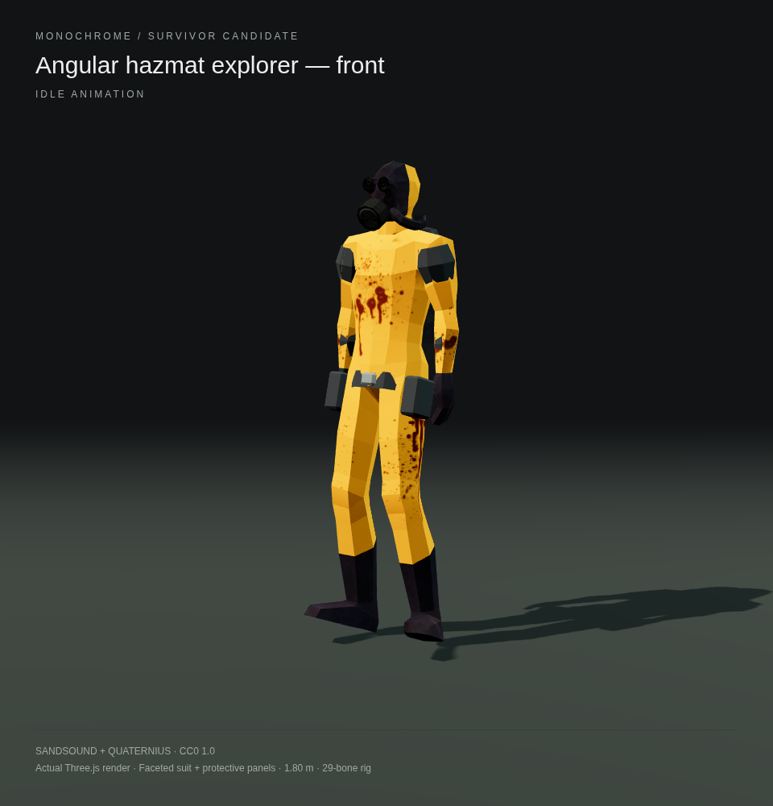
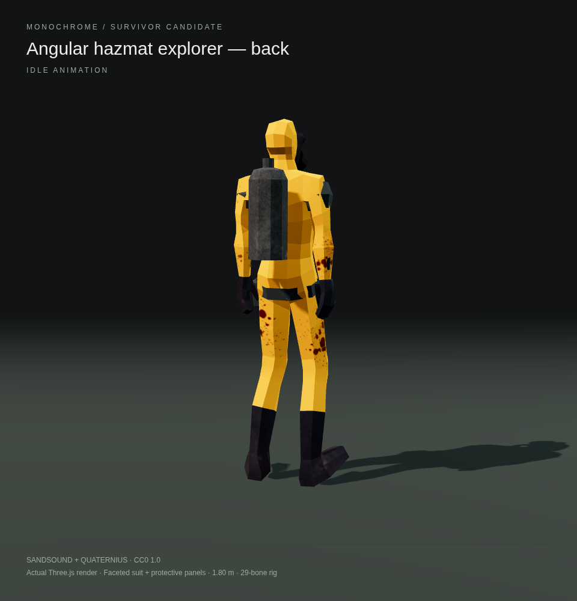
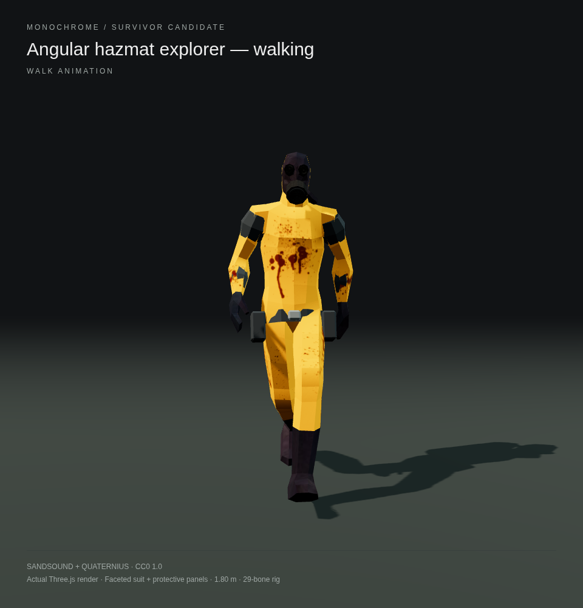
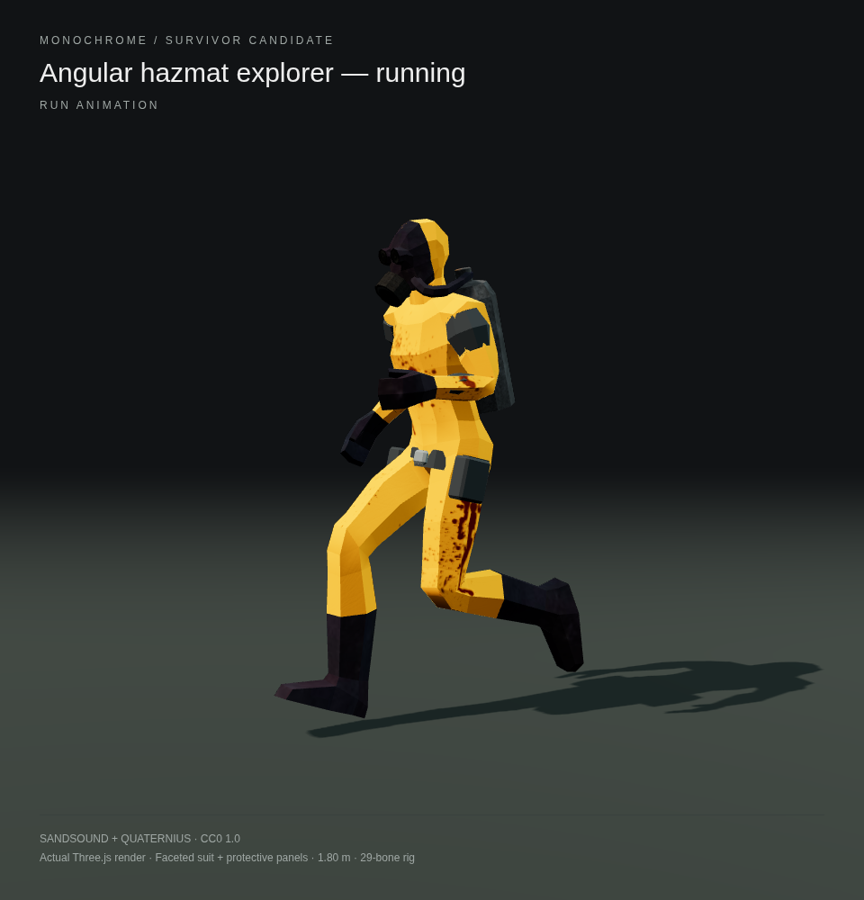
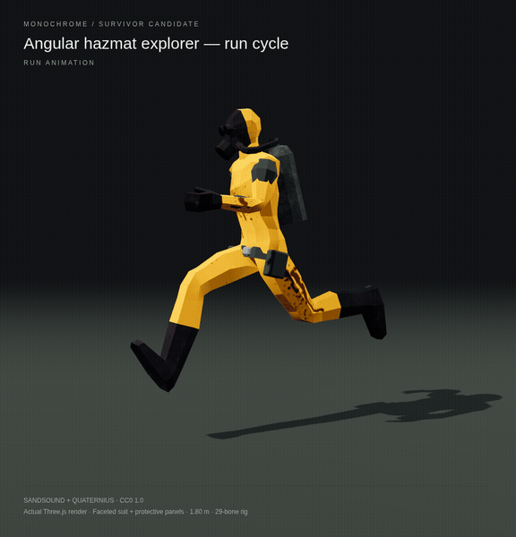

# Angular CC0 hazmat survivor

A sharper variation of the [smooth hazmat candidate](../hazmat-character/README.md), made for the request for more visible edges. The suit, hood, gas mask and boots use flat-shaded polygon faces. Faceted graphite shoulder caps, forearm guards, an octagonal utility belt, clipped-corner pouches and a metal buckle give it a more angular silhouette while keeping the yellow protective suit.

These images show the actual browser-ready model rendered in the game's Three.js 0.180.0, including its rigged protective equipment.

| Front / idle | Back / idle |
| --- | --- |
|  |  |

| Walking | Running |
| --- | --- |
|  |  |

[Download angular-hazmat-survivor.glb](../../../public/models/angular-hazmat-survivor.glb).

The self-contained GLB includes colour/normal textures, a 29-bone rig and five baked survivor clips: `Idle`, `Walk`, `Run`, `Jump`, `Death`. It uses the original low-poly suit topology rather than the subdivided smooth version. The added equipment is weighted to the appropriate arm or hip bones. Height is approximately 1.8 metres in the rest pose. Load with `GLTFLoader`, animate with `AnimationMixer`, and use `SkeletonUtils.clone` for independent teammates. No new game dependency is needed.

The underlying model is [Hazmat zombie by sandsound](https://opengameart.org/content/hazmat-zombie), based on a mesh credited to tigertowel; the human animations are from [Quaternius's Animated Men Pack](https://quaternius.com/packs/animatedmen.html). Both are CC0. The new protective geometry, modified model and preview renders are also dedicated under CC0 1.0. The [source licence and credits](SOURCE-LICENSE.txt) and [earlier provenance](../hazmat-character/README.md#licence-and-provenance) document the original sources.

The [verification report](verification.json) records the exported file hash, animation playback, finite skinned bounds and four independently cloned skeletons in Chromium/Three.js. The production build also copies the model correctly. This is an additional character option and preview gallery; the current game character has not been replaced.
