# B2 hooded figure reference images

**Selected character: The Hooded Wanderer by Ikk1.** The user selected this model for the B2 stranger on 20 October 2026.

The planned treatment is entirely black clothing, gloves, boots and fittings, with a featureless black hood interior. Monitor lighting will catch only the silhouette and cloth folds. The encounter uses restrained movement and a slow head turn before the monitor teaser.

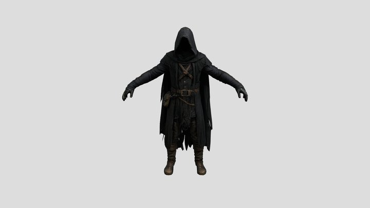

[Original model listing](https://sketchfab.com/3d-models/the-hooded-wanderer-e6bb88b557fd4efca786068af6960230) · [CC BY 4.0](https://creativecommons.org/licenses/by/4.0/) · Creator: Ikk1

## Import status

The reference preview is saved. The 3D model is not yet imported into the game. The listing reports 10,000 faces and no animations. Its official Sketchfab download requires authentication (HTTP 401 in the current session); a source GLB or FBX is needed to inspect the geometry, apply the black finish, and prepare the character animation.

[Original Meshy page linked by the listing](https://www.meshy.ai/3d-models/The-Hooded-Wanderer-v2-01967a42-82c8-732c-bc75-19b764bccc78), credited there to constantinemaddox. Preserve both source links when preparing the final asset credits.

## Other reviewed references

| Preview | Model and credit |
| --- | --- |
| 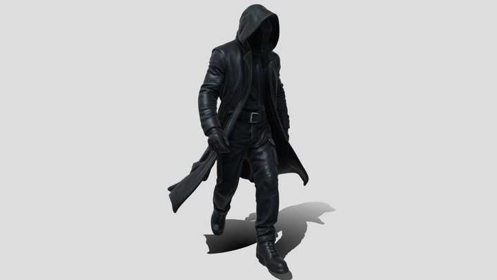 | **[Hooded Figure 3d Model Free](https://sketchfab.com/3d-models/none-e69ebfea7478492e8c80db2c3c8895a8)** By iRahulRajput [CC Attribution](https://creativecommons.org/licenses/by/4.0/) |
| 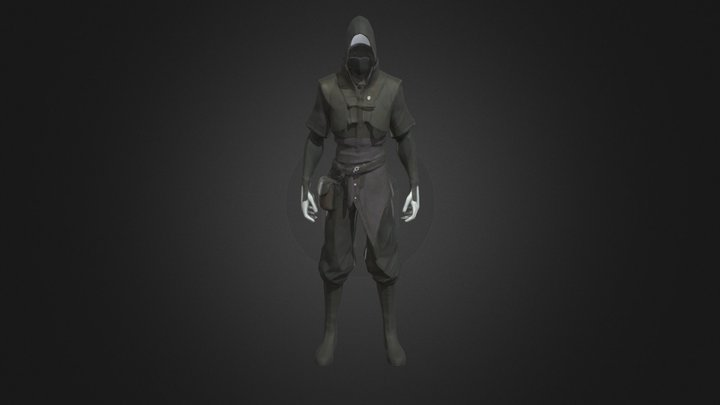 | **[Dark_Hooded_Rogue](https://sketchfab.com/3d-models/none-7dfc2cee5b334ad082e03dcff0209f53)** By SagePeeker [CC Attribution](https://creativecommons.org/licenses/by/4.0/) |
| 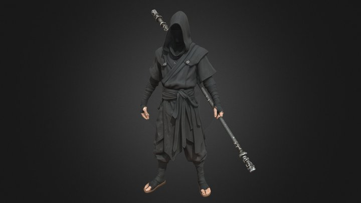 | **[Shadow Monk Assassin - Dark Fantasy](https://sketchfab.com/3d-models/none-317f8ab8cf7041c1abb070d603c041ab)** By Pigcraft [CC Attribution](https://creativecommons.org/licenses/by/4.0/) |
| 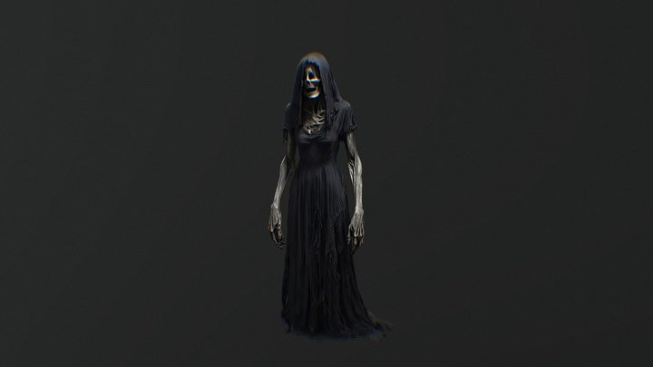 | **[Terrifying Hooded Horror Woman](https://sketchfab.com/3d-models/none-f59d17be392f4494a5b85d927df48ffd)** By Purple.Point [CC Attribution](https://creativecommons.org/licenses/by/4.0/) |
| 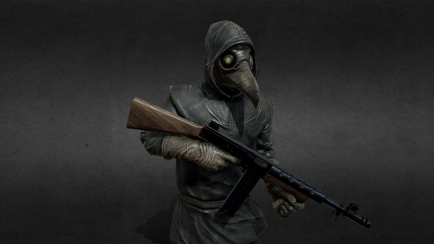 | **[Cultist armed](https://sketchfab.com/3d-models/none-63af0c04ad5d4d6180c15dd0c09d6a3a)** By DJMaesen [CC Attribution](https://creativecommons.org/licenses/by/4.0/) |
| 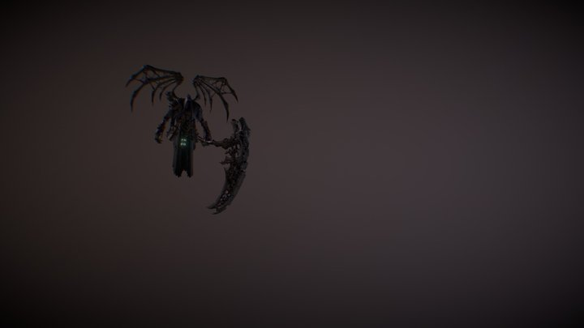 | **[GRIM REAPER](https://sketchfab.com/3d-models/none-304c48ee2bab4aabb61a99630d2008bb)** By NORBERTO-3D [CC Attribution](https://creativecommons.org/licenses/by/4.0/) |
| 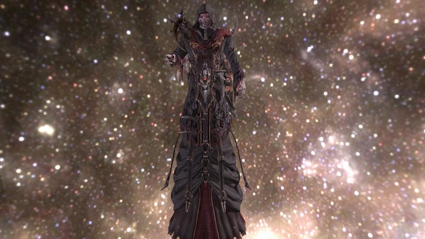 | **[Grim Reaper](https://sketchfab.com/3d-models/none-8767c43f4fc6444aa3d1ced5ff33d047)** By Vasian-Digital3D [CC Attribution](https://creativecommons.org/licenses/by/4.0/) |
| 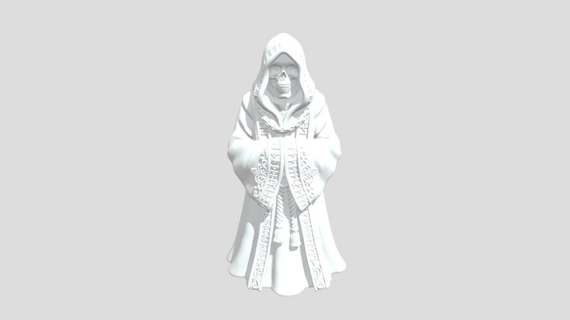 | **[Spooky: Cloaked Reaper](https://sketchfab.com/3d-models/none-83489603d36d40388d667c1125c26872)** By eSUN3D [CC Attribution](https://creativecommons.org/licenses/by/4.0/) |
| 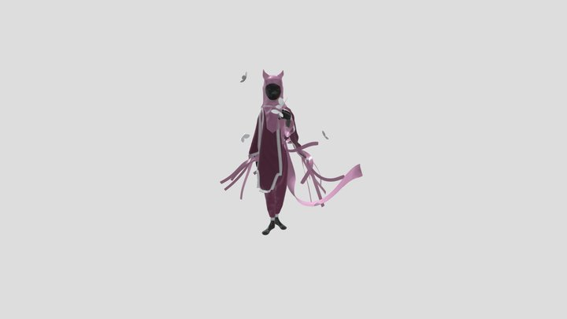 | **[Enigmatic Cloaked Wanderer](https://sketchfab.com/3d-models/enigmatic-cloaked-wanderer-dc0b172da7e74350a48fe637f9233af4)** By tahmidafroz003 [CC Attribution](http://creativecommons.org/licenses/by/4.0/) |
| 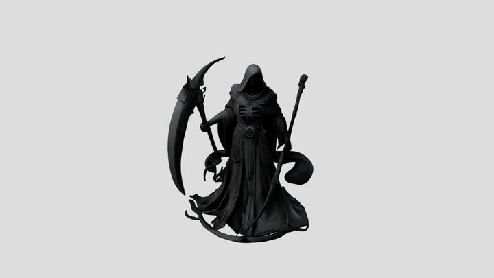 | **[Hooded Figure With Scythe](https://sketchfab.com/3d-models/hooded-figure-with-scythe-e713317859574b3583202eff64fa4ac4)** By SkellyCooks [CC Attribution](http://creativecommons.org/licenses/by/4.0/) |
| 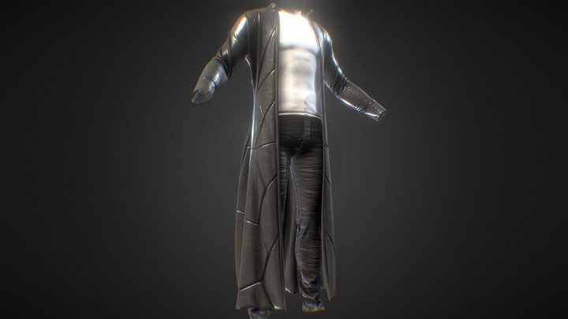 | **[a set of clothes "maniac's cloak" HIGH POLY](https://sketchfab.com/3d-models/a-set-of-clothes-maniacs-cloak-high-poly-880bea7e2614458194e72acebe23f652)** By DEYMAR [CC Attribution](http://creativecommons.org/licenses/by/4.0/) |
| 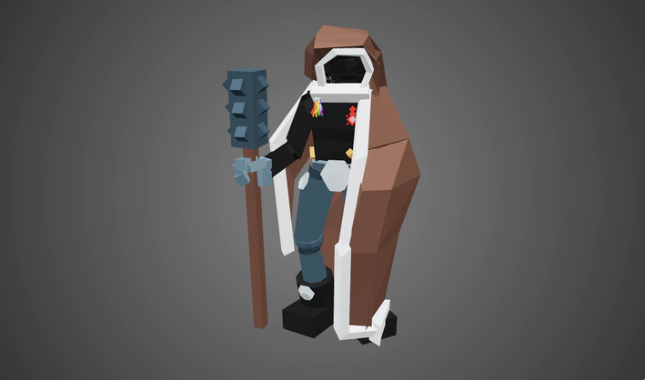 | **[Hooded Stranger](https://poly.pizza/m/0domsLgwnKq)** By Thomas DR [CC BY 3.0](https://creativecommons.org/licenses/by/3.0/) |
| 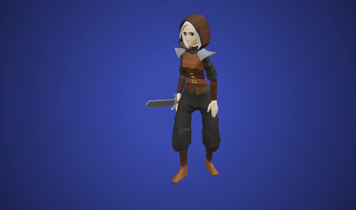 | **[Hooded Adventurer](https://poly.pizza/m/y9KWOVG21R)** By Quaternius [CC0 1.0](https://creativecommons.org/publicdomain/zero/1.0/) |

Previews retain their source appearance; the all-black treatment is a planned game adaptation. Source and licence details are preserved in [SOURCE-LICENSE.txt](SOURCE-LICENSE.txt), with image origins and checksums in [references.json](references.json).
