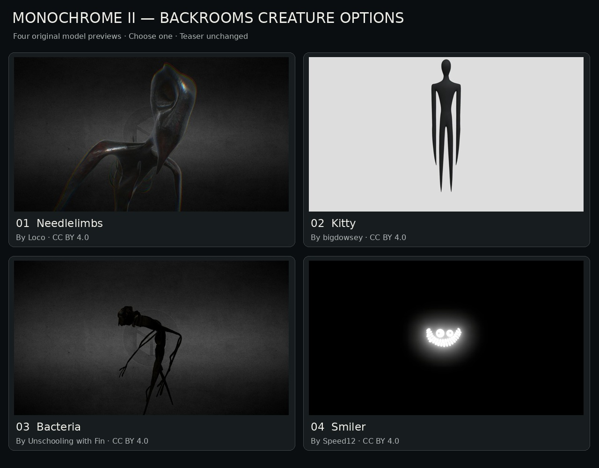
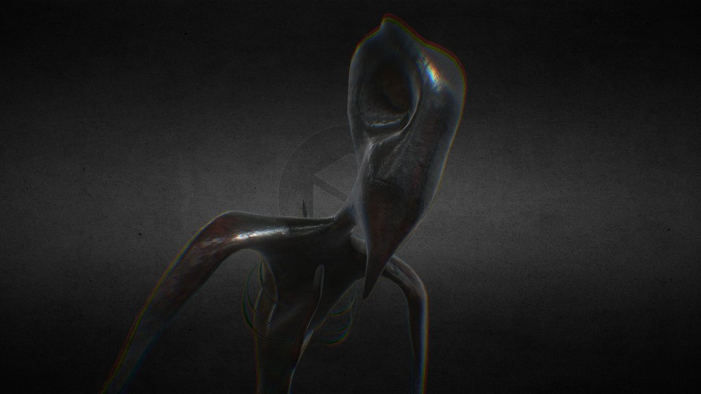
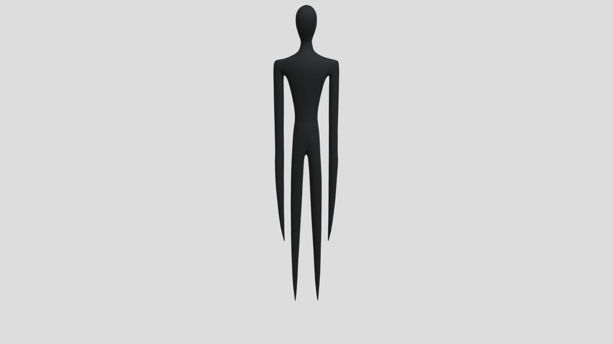
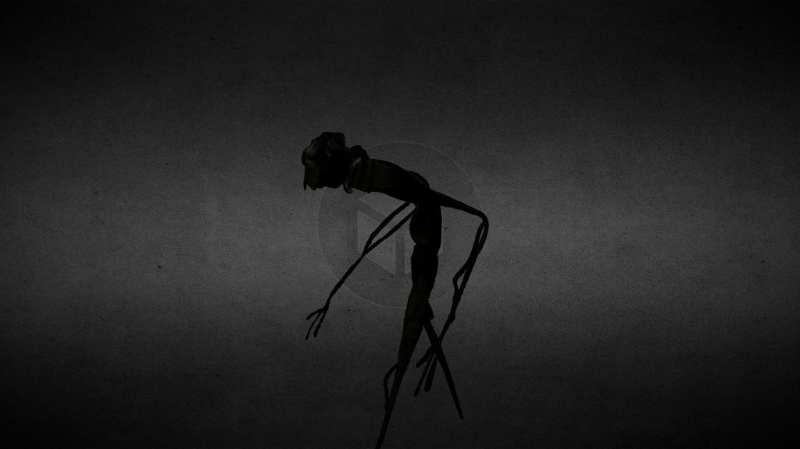
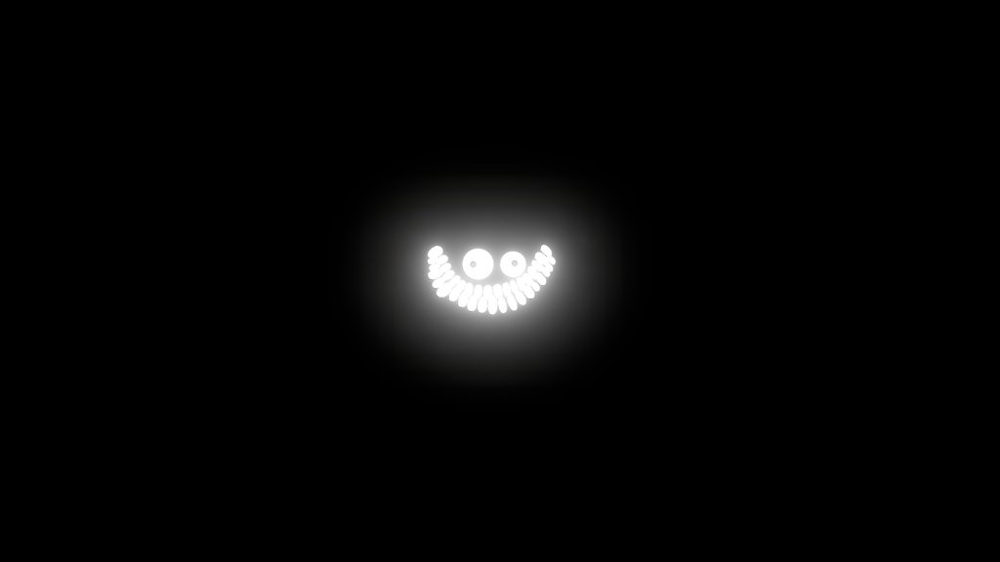

# Monochrome II — darker Backrooms-style options

**Selected: 1 — Needlelimbs by Loco.** Source download is pending; the replacement teaser is staged. [Mechanical Monochrome design and status](../mechanical-monochrome/README.md).

A new shortlist focused on black silhouettes, strange proportions and barely visible faces. These are **four choices for one creature**, with original model previews. Needlelimbs has been selected but not imported; the current public teaser is unchanged.

The chosen Needlelimbs silhouette will be used for the brief corner reveal once the actual source rig has been inspected.

[Open full comparison](comparison.jpg)

## Source and download status

Checked on 21 October 2026. All four official Sketchfab listings report downloadable models and a CC BY 4.0 license. Their official download endpoints returned HTTP 401 here, so an authorized signed-in download is still needed. **These files are preview images, not the 3D assets.**

The images retain their source appearance. The proposed shots below are suggestions for the teaser, not implemented animations. These listings depict existing Backrooms entities; their names and lore are not new Monochrome II characters. Credits and the selected source files must be reviewed before import.

## 1 — Needlelimbs

My recommendation. A black, crooked body with an elongated head and needle-like fingers. A slow sideways head reveal would be difficult to read, which makes it unsettling.

**Possible shot:** One distorted head and a hand emerge from a corner. The rest stays hidden.

**Original model:** [Backrooms Entity 38 Needlelimbs](https://sketchfab.com/3d-models/backrooms-entity-38-needlelimbs-6e8ad10cbcbb49bda63a1b21a660533d)

**Creator:** [Loco](https://sketchfab.com/Loco420) · [CC BY 4.0](https://creativecommons.org/licenses/by/4.0/)

[Open full preview](01-needlelimbs.jpg)

## 2 — Kitty

An almost completely black, featureless humanoid with extremely long limbs. The clean silhouette works well at the end of a dim hallway.

**Possible shot:** A tall shape appears beyond a doorway, then silently withdraws.

**Original model:** [Kitty - Backrooms Entity](https://sketchfab.com/3d-models/kitty-backrooms-entity-8aa2afeaa1b645fa8f29542eef09d3b9)

**Creator:** [bigdowsey](https://sketchfab.com/bigdowsey) · [CC BY 4.0](https://creativecommons.org/licenses/by/4.0/)

[Open full preview](02-kitty.jpg)

## 3 — Bacteria

A tangled, uneven creature with thin limbs and a dark, twisted head. It has the strongest familiar found-footage Backrooms appearance.

**Possible shot:** A partial silhouette moves across a distant opening. Keep the full body out of view.

**Original model:** [Accurate Backrooms Bacteria v2 with Animations](https://sketchfab.com/3d-models/accurate-backrooms-bacteria-v2-with-animations-c067bae794c14fc1969fe22605cdd837)

**Creator:** [Unschooling with Fin](https://sketchfab.com/UnschoolingWithFin) · [CC BY 4.0](https://creativecommons.org/licenses/by/4.0/)

[Open full preview](03-bacteria.jpg)

## 4 — Smiler

Glowing eyes and a broad grin suspended in blackness. The most minimal option: the darkness hides almost everything.

**Possible shot:** The face becomes visible in an unlit doorway, then vanishes as the light flickers.

**Original model:** [Accurate Smiler Backrooms Blender 3.22](https://sketchfab.com/3d-models/accurate-smiler-backrooms-blender-322-902975161a7047baa5cda8fb7b5a292e)

**Creator:** [Speed12](https://sketchfab.com/Speed12) · [CC BY 4.0](https://creativecommons.org/licenses/by/4.0/)

[Open full preview](04-smiler.jpg)

## Listing details

Official API values, not an inspection of source files. Published animations do not establish suitability for the final shot. A zero animation count does not establish that a model is unrigged.

| Option | Triangles | Published animations | Download status |
| --- | ---: | ---: | --- |
| 1 — Needlelimbs | 14,539 | 2 | Sign-in required (401) |
| 2 — Kitty | 960,000 | 0 | Sign-in required (401) |
| 3 — Bacteria | 231,424 | 5 | Sign-in required (401) |
| 4 — Smiler | 5,920 | 0 | Sign-in required (401) |

Kitty and Bacteria would need a performance review and likely mesh optimization before browser use.

[Attributions](SOURCE-LICENSE.txt) · [Source metadata and checksums](references.json) · [Previous shortlist](../teaser-creature-shortlist/README.md)
