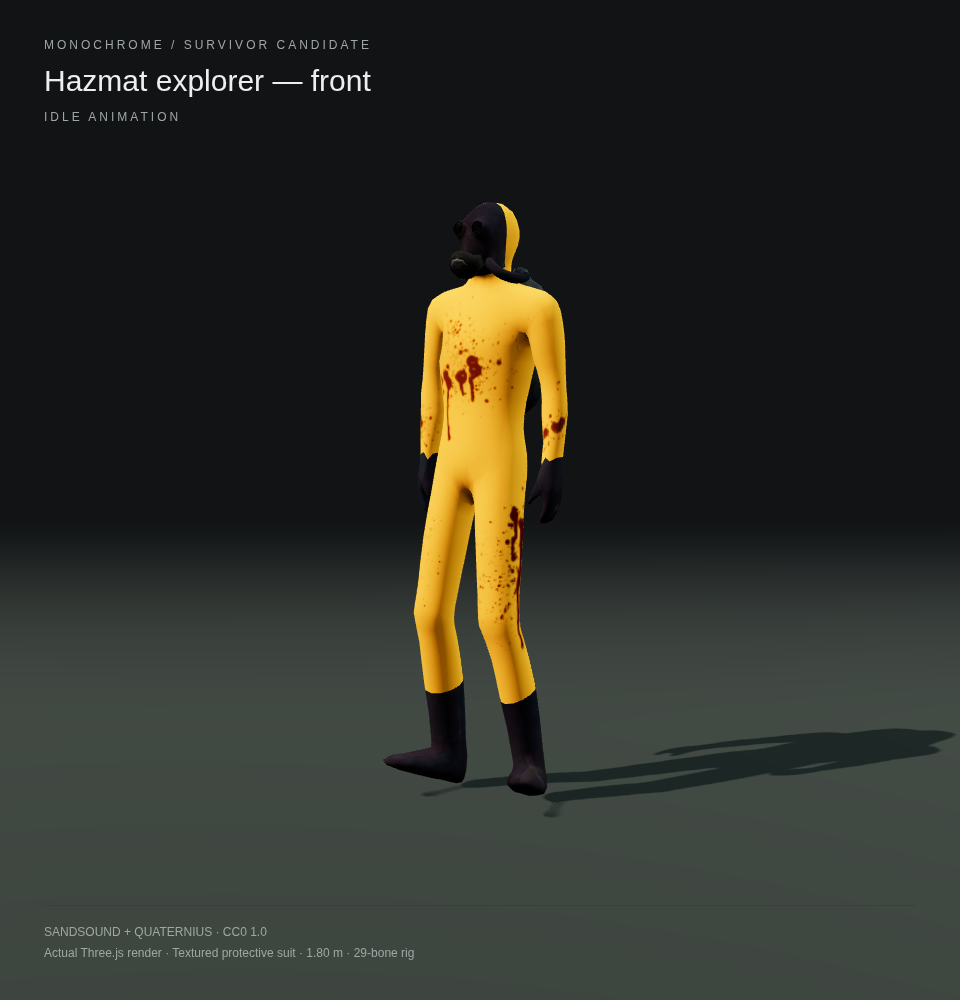
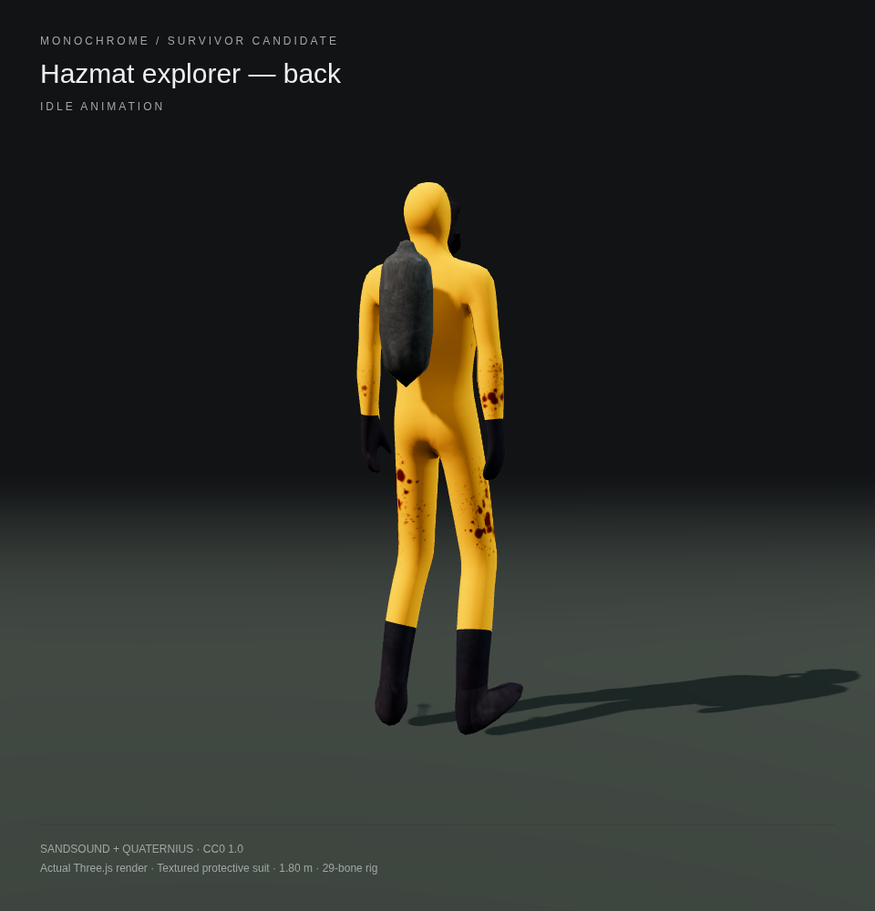
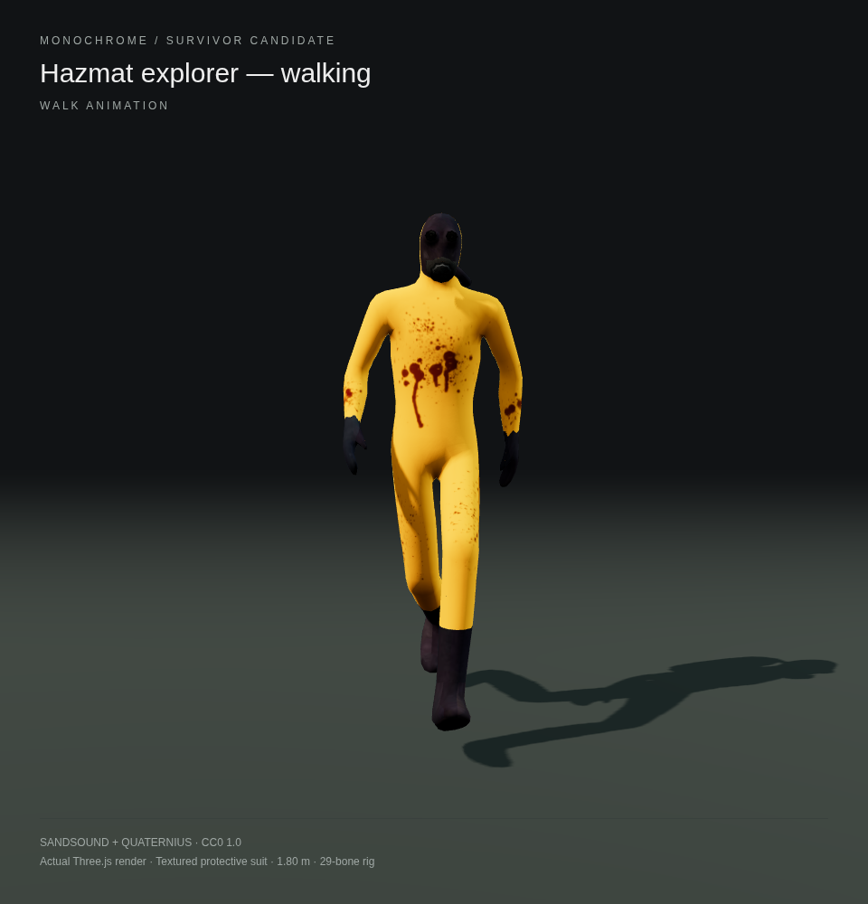
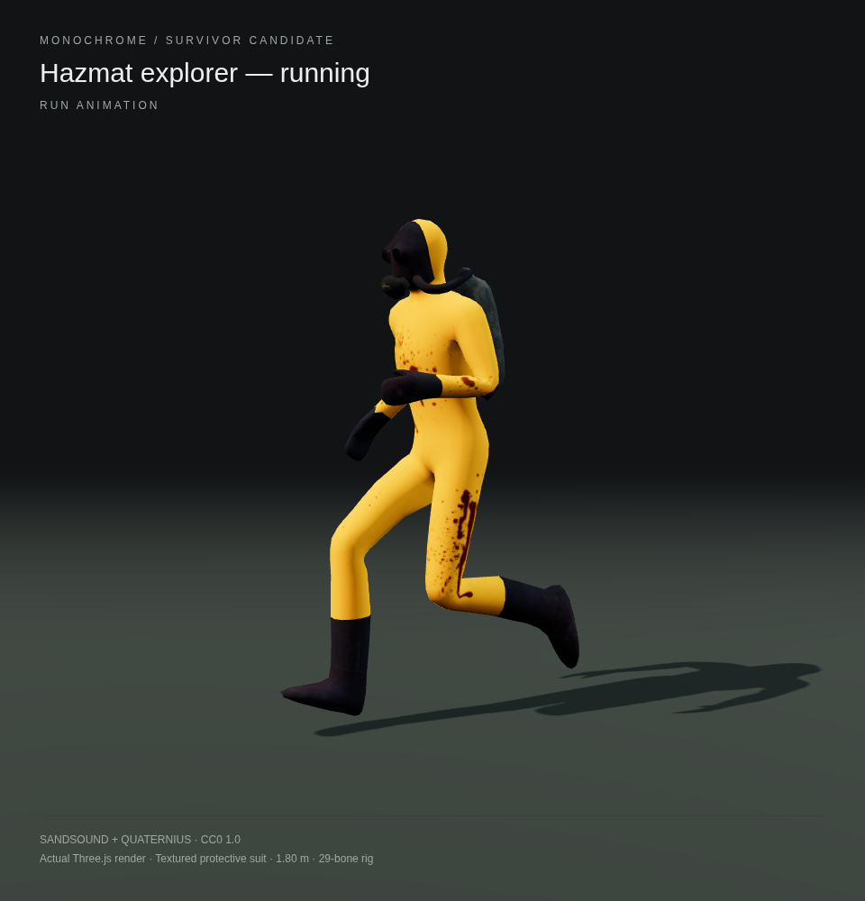
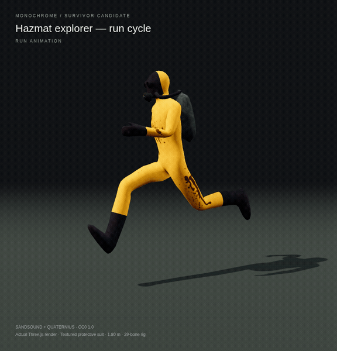

# CC0 Backrooms-style hazmat survivor

A closer visual match to the requested yellow protective suit: a dark gas mask, gloves, rubber boots, textured yellow clothing and breathing equipment. This is a stylized, normal-proportion character with a worn/blood-stained suit, rather than an exact reproduction of the reference photograph or a photorealistic model.

The source is **[Hazmat zombie by sandsound](https://opengameart.org/content/hazmat-zombie)**, published under **CC0**. For a living multiplayer survivor, this variant replaces the zombie actions with retargeted **CC0 Quaternius human animations**, smooths the mesh, and exports a browser-ready GLB. The images below are actual Three.js renders of that file.

| Front / idle | Back / idle |
| --- | --- |
|  |  |

| Walking | Running |
| --- | --- |
|  |  |

## Asset and compatibility

[Download hazmat-survivor.glb](../../../public/models/hazmat-survivor.glb). The file is self-contained, approximately 4.95 MiB, with embedded colour and normal textures, 4,316 triangles, a 29-bone skin and five baked clips: `Idle`, `Walk`, `Run`, `Jump`, `Death`. It is normalized to approximately 1.8 metres in the rest pose. No Draco decoder, account, paid service or new JavaScript dependency is required.

Use Three.js `GLTFLoader` and `AnimationMixer`, already compatible with this game's Three.js 0.180.0. Clone the character using `SkeletonUtils.clone` so each teammate has an independent skeleton. Player movement and collision must continue to use the game's controller and collision shape; this visual asset does not implement those systems.

The asset and previews are supplied for selection. It has not replaced the current character or been connected to multiplayer. The earlier [grey human candidate](../player-character/README.md) is retained for comparison.

## Licence and provenance

Both source components are **CC0 1.0 Universal**. The modified GLB and these preview renders are also dedicated under CC0 1.0. See [licence and credits](SOURCE-LICENSE.txt).

- Model: [Hazmat zombie, sandsound, January 27, 2023](https://opengameart.org/content/hazmat-zombie). The author credits the original Lowpoly Zombie mesh to **tigertowel**. The asset page explicitly lists CC0.
- Original download: <https://opengameart.org/sites/default/files/hazmat.blend>.
- Source Blender SHA-256: `c6760a3d095ec4e4a7c92fae7fcefce4fb76962bea12ed6372b493879c2733b2`.
- Survivor animations: [Quaternius Animated Men Pack](https://quaternius.com/packs/animatedmen.html), CC0, using the previously verified source described in the [first candidate's provenance](../player-character/README.md#licence-and-provenance).
- Conversion: Blender 4.3.2. Validate geometry, apply one subdivision level with interpolated skin weights and UVs, enable smooth normals, preserve embedded colour/normal textures, make the suit matte, retarget human actions to the hazmat rig with bone-roll corrections, bake at 30 fps, normalize scale and export glTF 2.0 binary. Existing zombie actions are excluded.

## Checks performed

The [verification report](verification.json) contains the exported file hash and Chromium/Three.js results. All five animations load and move bones; deformed bounds remain finite at five sampled times in every clip, and no browser errors were reported. Four cloned player skeletons were checked for independence. The GLB has no external resource references. Front, back, walk and run renders were inspected. These checks verify model playback and compatibility, not completed multiplayer gameplay or every mobile GPU.
