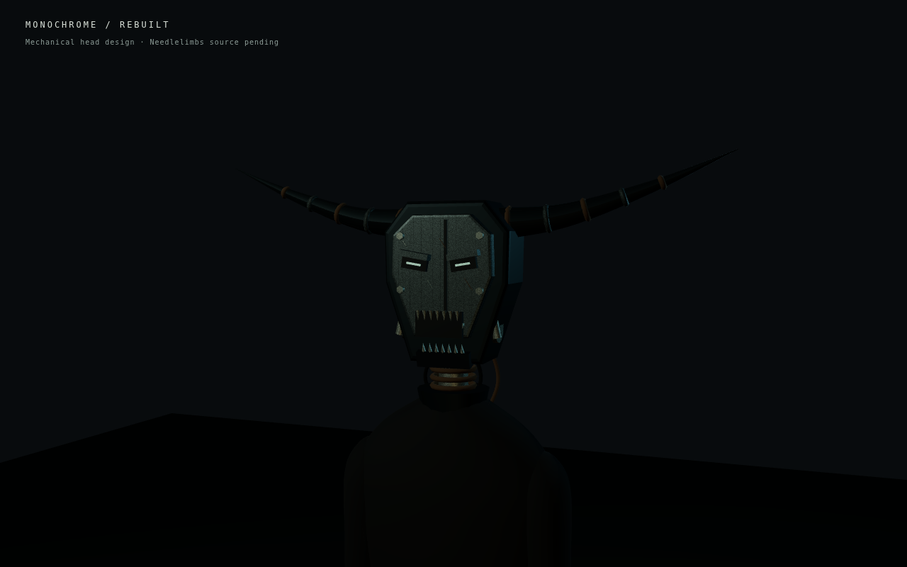

# Monochrome — rebuilt mechanical head

Original game geometry, authored for the revised Monochrome II teaser. This is a replacement head attached to the existing Monochrome body. The original wide horn silhouette remains, with segmented metal horns, an angular faceplate, recessed eye slits, exposed jaw hinges, steel teeth and a repaired neck with cables and clamps. Small scratches and a deterministic wear texture break up the steel finish.

[Side view](side.png) · [Full-body view](body.png)

The jaw, head and existing body rig move independently. The staged film reveals the repair in a sustained close shot after Monochrome walks up behind Needlelimbs, accompanied by the game's existing credited monster recording.

## Current status

**The new teaser is staged, not active.** The selected [Needlelimbs by Loco](https://sketchfab.com/3d-models/backrooms-entity-38-needlelimbs-6e8ad10cbcbb49bda63a1b21a660533d) still requires a signed-in official download. The source GLB/FBX has not been obtained. These screenshots show only the authored Monochrome design, not a substitute for Needlelimbs.

The source must be imported, its native walking animation and head bone inspected, and the full shot visually verified before enabling the replacement edit. The current public teaser remains available while that file is missing.
