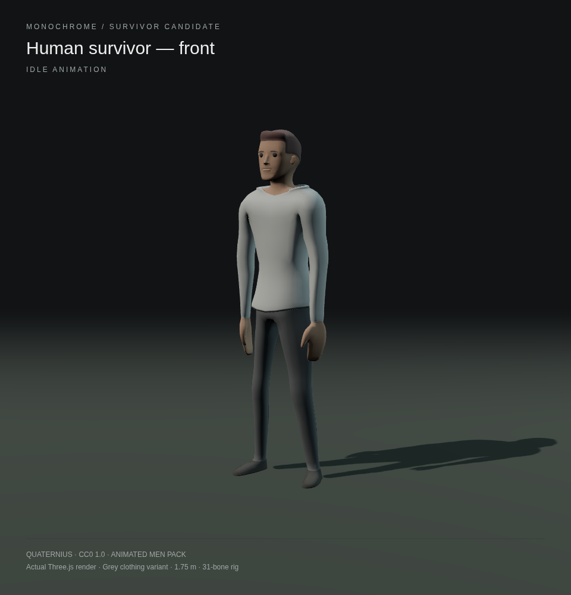
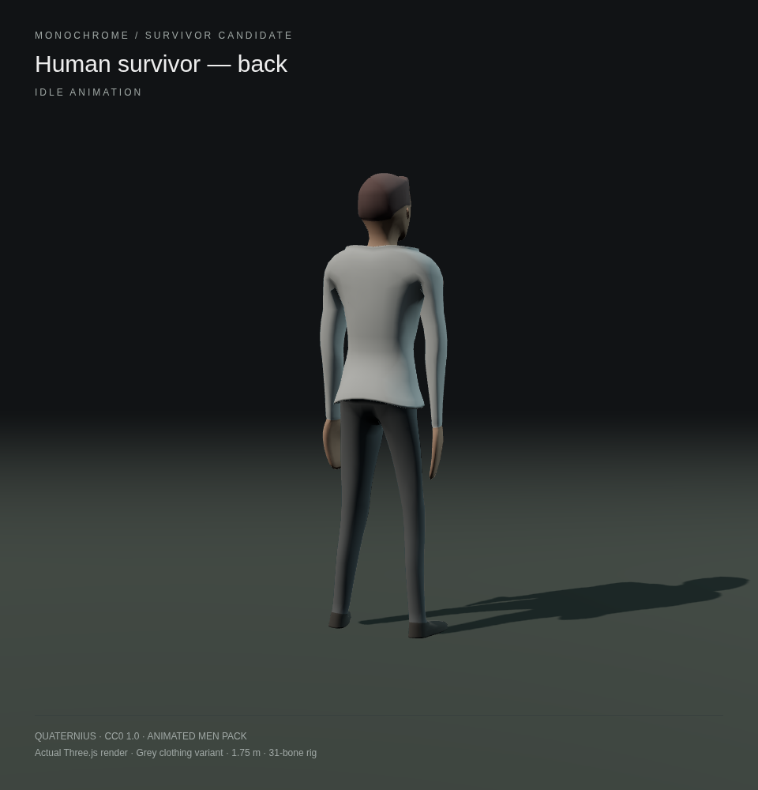
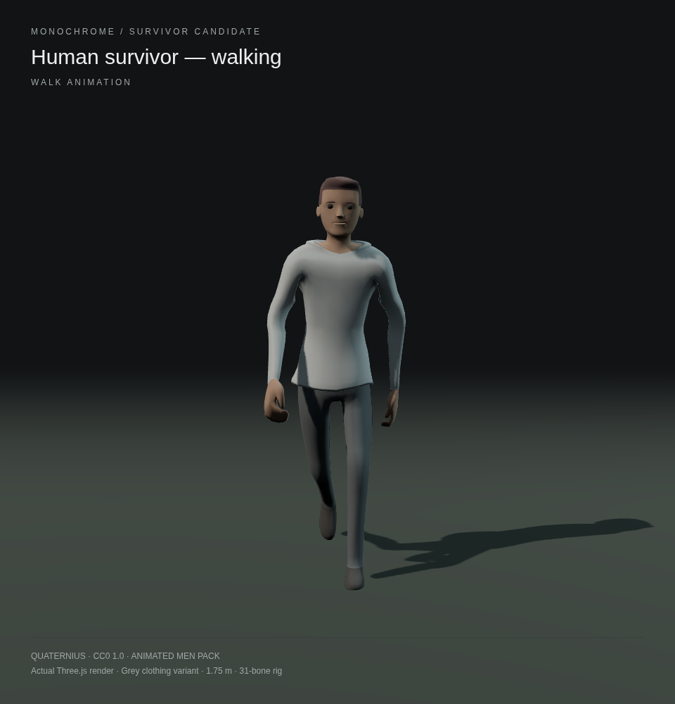
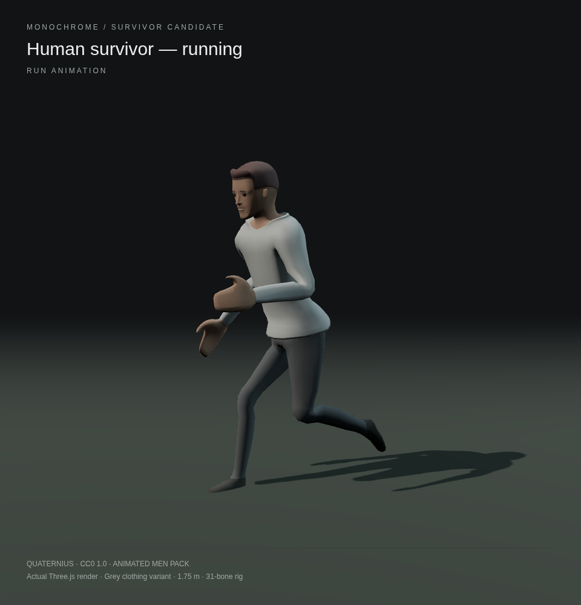
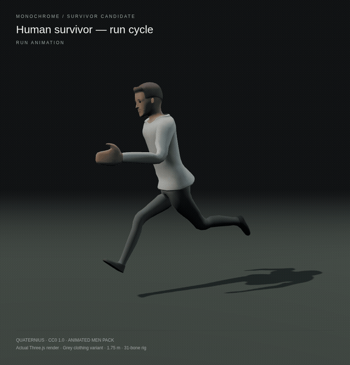

# CC0 survivor character

Selected for the future multiplayer **human player avatar**: Quaternius's **Smooth Male Long Sleeve**, from the [Animated Men Pack](https://quaternius.com/packs/animatedmen.html). Normal human proportions, a readable face, long sleeves and dark trousers distinguish teammates from the black horned creature. The supplied variant uses grey clothing to fit the game's subdued setting.

These are renders of the actual downloadable model in **Three.js 0.180.0**, the version used by this game. They are not concept art.

| Front / idle | Back / idle |
| --- | --- |
|  |  |

| Walking | Running |
| --- | --- |
|  |  |

## Animation preview

## Browser-ready asset

- [Download survivor.glb](../../../public/models/survivor.glb): self-contained glTF 2.0 binary, approximately 0.65 MiB; no external textures, network services, animation subscriptions or paid dependencies.
- 31 bones, five skinned material groups, 8,404 triangles, approximately 1.75 metres tall. Smooth normals, matte grey top, dark trousers and footwear; original skin and hair colours retained.
- 12 named clips: `Idle`, `Walk`, `Run`, `Jump`, `RunningJump`, `Death`, `Sitting`, `Standing`, `Roll`, `Punch`, `Clapping`, `SwordSlash`. Combat clips are included as source material, not proposed game mechanics.
- Load with the existing Three.js `GLTFLoader`; play clips with `AnimationMixer`. Use `SkeletonUtils.clone` for independently animated teammates. No new game dependency is needed.
- This adds the model and previews for review. Multiplayer controls, networking, torch attachment, numbered uniforms and state-driven animation transitions are not connected yet. Collision should use the game's player capsule, rather than the visual mesh. The existing monster is unchanged by this asset addition.

## Licence and provenance

**CC0 1.0 Universal**, verified against the author's pack page and the distributor's included [licence text](SOURCE-LICENSE.txt). CC0 permits copying, modifying and commercial redistribution without an attribution requirement. Credit is retained here voluntarily.

- Author: [Quaternius](https://quaternius.com/).
- Author's pack and licence declaration: <https://quaternius.com/packs/animatedmen.html>.
- Licence: <https://creativecommons.org/publicdomain/zero/1.0/>.
- Author's public download folder: <https://drive.google.com/drive/folders/17LibivOaUidsQhSkcxP3YYvDr0n7wIwu>.
- The public Drive download reported a quota error. The same named source was obtained from the public [FreeAssetsByKenneyNLandQuaternius mirror, pinned to commit dea756baf3b3a4889d8c245e456a4791f961578a](https://github.com/beep2bleep/FreeAssetsByKenneyNLandQuaternius/tree/dea756baf3b3a4889d8c245e456a4791f961578a).
- Source path in that mirror: `FreeModels by Quaternius[Patreon]/Characters and Animals/Animated Men Characters - Feb 2019/Blends/Smooth_Male_LongSleeve.blend`.
- Source Blender SHA-256: `5e191e44c03a1ce9dc746d17da2ccd6bbac578065f6688aad8162edbf995bb22`.
- Conversion: Blender 4.3.2; validate mesh, enable smooth normals, rebuild plain PBR materials, recolour clothing, normalize height, remove animation channels referencing absent finger bones, bake the twelve existing actions at 30 fps, export embedded GLB with standard four-weight skinning. No Draco decoder is required.
- The modified model and preview renders are also dedicated under CC0 1.0.

## Verification

The [verification report](verification.json) records the exported file hash and the actual Chromium/Three.js check. All twelve clips were loaded and sampled, all produced bone movement, skinning bounds stayed finite at five points in every clip, and the browser reported no script or console errors. The file contains no external resource references. Front, back, walking and running views were inspected after rendering. This verifies asset loading and animation playback; it does not claim multiplayer integration or testing on every phone/GPU.
