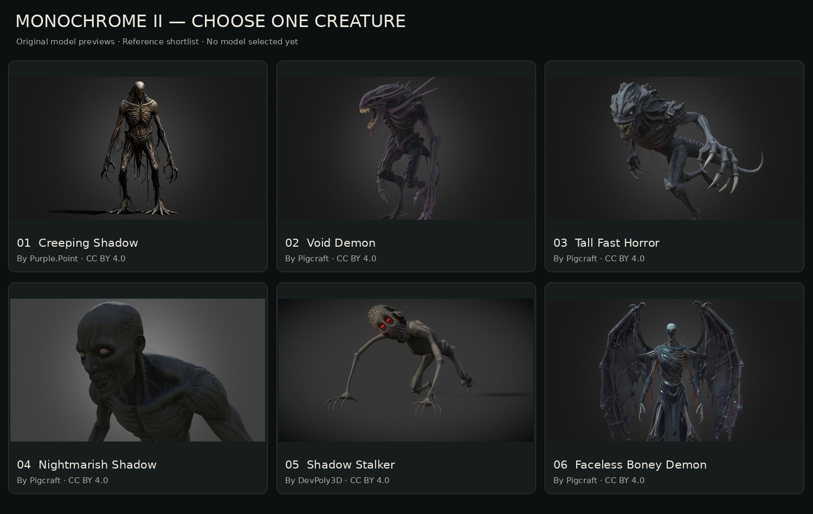
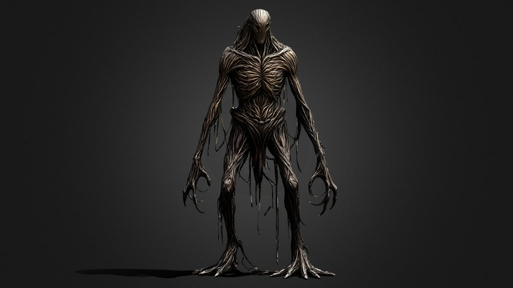
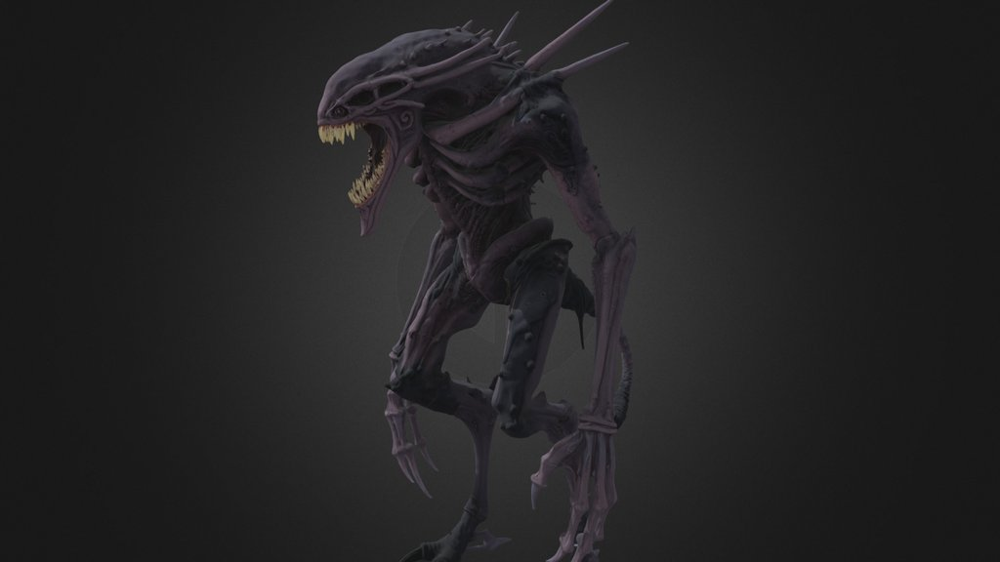
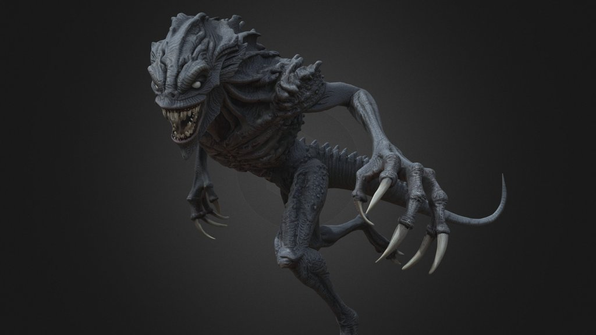
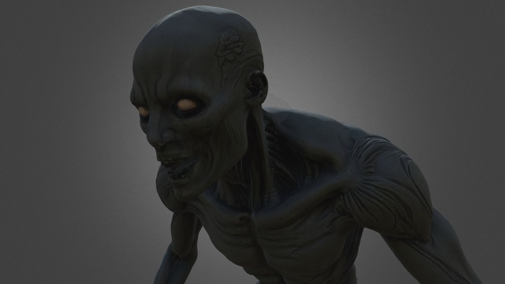
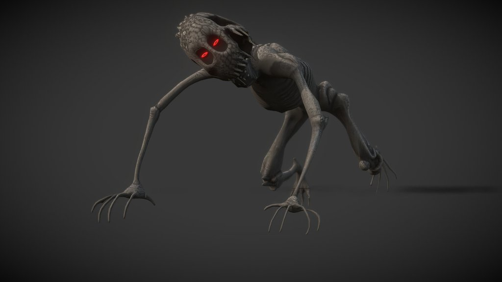
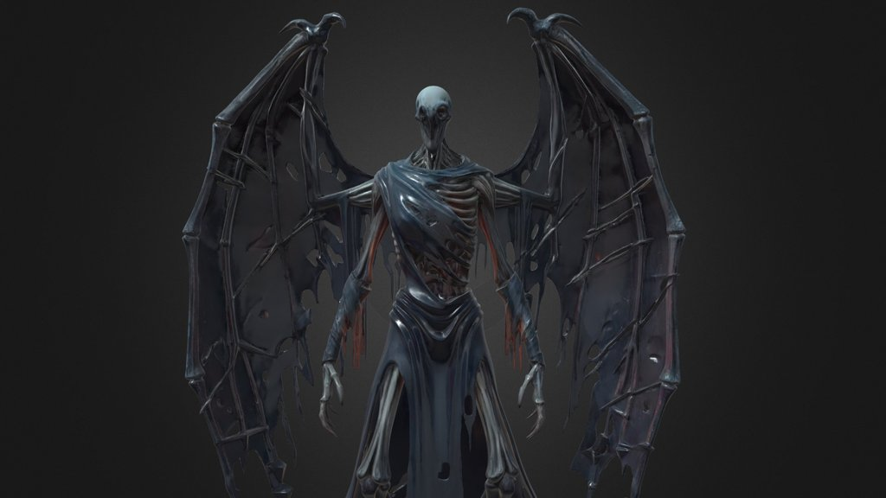

# Monochrome II — choose one creature

**New direction:** [Darker Backrooms-style creature shortlist](../backrooms-creature-shortlist/README.md).

Six dark creature options for **one** subtle introduction in the B2 monitor teaser. No selection has been made. This gallery does not change the current teaser or gameplay.

**My recommendation: 1 — Creeping Shadow.** Its narrow face and long fingers would read clearly in a short doorway reveal. Choose a number after comparing the original previews below.

[Open the full comparison image](comparison.jpg)

## Download and import status

Checked on 21 October 2026. All six official Sketchfab listings report downloadable models under **CC BY 4.0**, which allows adaptation and commercial use with attribution. Their official download endpoints require a signed-in account (HTTP 401 here). **Only preview images are saved; no 3D source files have been downloaded or imported.** The chosen model will need an authorized source download before implementation.

The previews retain the creators’ original appearance. Model animation, rigging, textures and performance still need inspection from the source files. Several models have very high triangle counts and would need optimization for smooth browser gameplay.

## 1 — Creeping Shadow

My pick. A narrow, featureless head, exposed rib-like shapes and very long fingers. Show its head easing around a doorframe, followed by just one hand.

**Original model:** [Creeping Shadow Creature – Free Horror 3D Model](https://sketchfab.com/3d-models/creeping-shadow-creature-free-horror-3d-model-53e77576ca0b4c5988ba2991a4bff075)

**Creator:** [Purple.Point](https://sketchfab.com/Purple.Point) · [CC BY 4.0](https://creativecommons.org/licenses/by/4.0/)

[Open full preview](01-creeping-shadow.jpg)

## 2 — Void Demon

Dark skin, a long jaw and a hunched silhouette. A sideways glimpse of the mouth and claws would be enough to suggest something dangerous.

**Original model:** [Void Demon Stalker Creature](https://sketchfab.com/3d-models/void-demon-stalker-creature-8576d7a73d8d462fbe5d765afe6d8136)

**Creator:** [Pigcraft](https://sketchfab.com/s8819296) · [CC BY 4.0](https://creativecommons.org/licenses/by/4.0/)

[Open full preview](02-void-demon.jpg)

## 3 — Tall Fast Horror

One of your original linked choices. A low stalking pose, large claws and a ridged head. Could briefly lean into a distant corridor before retreating.

**Original model:** [Tall Fast Horror Monster with Long Claws](https://sketchfab.com/3d-models/tall-fast-horror-monster-with-long-claws-74a81838ee6045a9b4df581b90bd68bb)

**Creator:** [Pigcraft](https://sketchfab.com/s8819296) · [CC BY 4.0](https://creativecommons.org/licenses/by/4.0/)

[Open full preview](03-tall-fast-horror.jpg)

## 4 — Nightmarish Shadow

A dark humanoid face with hollow-looking eyes. Best for a slow face reveal from the edge of a doorway, with most of its body hidden.

**Original model:** [Nightmarish Shadow Horror](https://sketchfab.com/3d-models/nightmarish-shadow-horror-03439fb6d19f4472aecfa1b4f72c4936)

**Creator:** [Pigcraft](https://sketchfab.com/s8819296) · [CC BY 4.0](https://creativecommons.org/licenses/by/4.0/)

[Open full preview](04-nightmarish-shadow.jpg)

## 5 — Shadow Stalker

Long, spindly limbs, a crawling pose and red eyes. Better suited to a low glimpse near the floor than a standing corner peek.

**Original model:** [Shadow Stalker – Horror Creature 3D Model](https://sketchfab.com/3d-models/shadow-stalker-horror-creature-3d-model-298b244a438949f99a6869961186bf99)

**Creator:** [DevPoly3D](https://sketchfab.com/DevPoly3D) · [CC BY 4.0](https://creativecommons.org/licenses/by/4.0/)

[Open full preview](05-shadow-stalker.jpg)

## 6 — Faceless Boney Demon

A smooth pale face on a dark skeletal body, with large ragged wings. The most supernatural option; a partial face reveal would keep its full shape mysterious.

**Original model:** [Faceless Boney Horror Demon](https://sketchfab.com/3d-models/faceless-boney-horror-demon-8d896c8d527f463985115d526c23c039)

**Creator:** [Pigcraft](https://sketchfab.com/s8819296) · [CC BY 4.0](https://creativecommons.org/licenses/by/4.0/)

[Open full preview](06-faceless-boney-demon.jpg)

## Technical listing details

Reported by the official API; these are listing values, not an inspection of the downloadable files. An animation count of zero means no published animations were reported, not proof that the model is unrigged.

| Option | Triangles | Published animations | Official download check |
| --- | ---: | ---: | --- |
| 1 — Creeping Shadow | 99,197 | 0 | Sign-in required (401) |
| 2 — Void Demon | 1,911,706 | 0 | Sign-in required (401) |
| 3 — Tall Fast Horror | 1,390,188 | 0 | Sign-in required (401) |
| 4 — Nightmarish Shadow | 1,902,032 | 0 | Sign-in required (401) |
| 5 — Shadow Stalker | 17,301 | 0 | Sign-in required (401) |
| 6 — Faceless Boney Demon | 955,638 | 0 | Sign-in required (401) |

[Source records and preview checksums](references.json) · [Attributions](SOURCE-LICENSE.txt)
